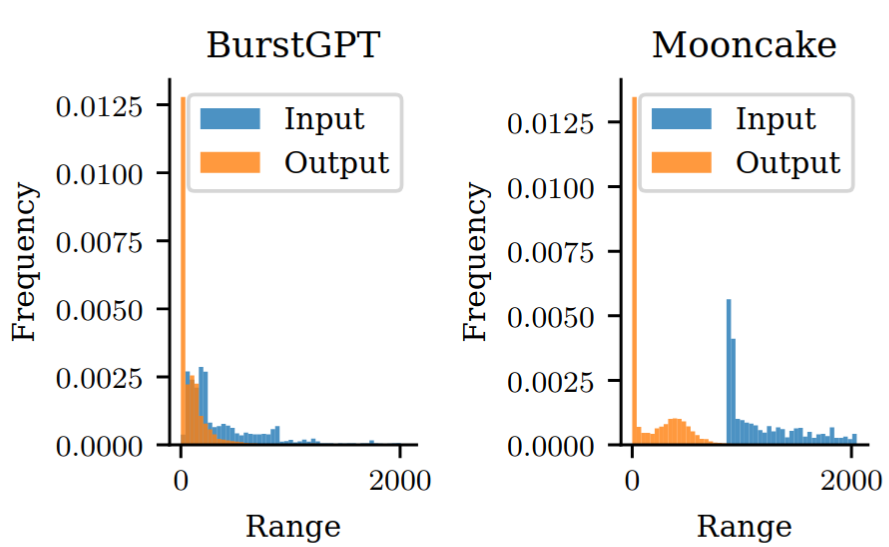
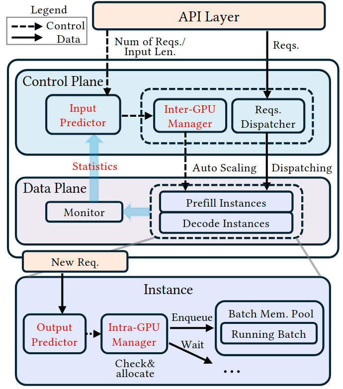
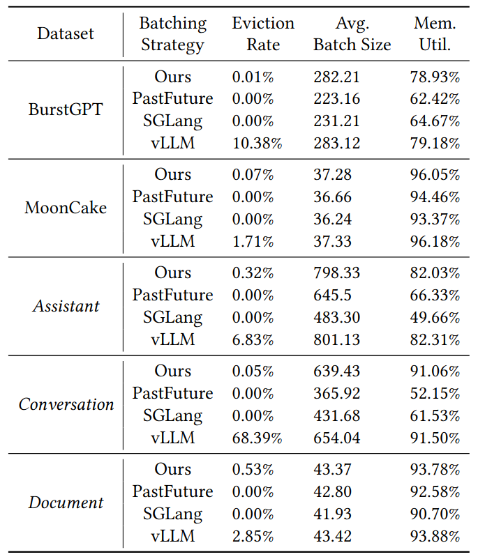

**PiLLM: Resource-Efficient LLM Inference Using Workload Prediction（EuroSys 2026，CCF-A）**
- 文章链接：https://dl.acm.org/doi/10.1145/3767295.3769393
- 代码链接：无
- 简述：通过历史请求长度统计预测 Batch的计算和显存需求，并将其转换为 FLOPs 和 Memory 估计。在此基础上，分别进行 GPU 实例内的 Batch 级显存管理，以及跨 GPU 实例的资源规划和动态请求分配，从而提高 GPU 利用率并保证 SLO。

# 1. 文章思路
这篇文章可以算是Past-Future Scheduler for LLM Serving under SLA Guarantees后续工作，前一篇是通过预测请求输出长度，来估计Batch内存的占用峰值，从而控制请求的准入。这篇论文是针对集群，对单个实例的内存占用进行估计。

同样这里文章指出传统两类内存分配策略的不足：
- 激进： 如vLLM，会在一个batch中放入尽可能多的请求。请求在decode阶段时，一个请求每次只分配一个token的内存额度。`通常会导致eviction`
- 保守：给每个请求一个固定足够的内存额度，`通常会造成资源浪费`

# 2. 设计思路
这里文章调度分为两部分，一个是GPU`实例内`(这里是实例是运行完整大模型的一张显卡)的调度，一个是`跨实例`的调度：

- 实例内调度： 基于历史请求输出长度分布预测新请求的输出长度，并将其转换为计算量和显存需求，用于`估计 GPU 资源需求`。

- 跨实例调度： 根据计算需求动态调整实例的`个数`，并且实现新到请求的分配。在出现请求突增时，如何应对。

## 2.1 实例内调度
这里文章做了一个实验，虽然请求的输出长度是呈现下图中分布。但是一个batch中的请求输出长度数量相加是呈现正态分布的，根据中心极限定理。

根据这个我们通过知道历史请求的输出长度，可以计算出在一个置信区间内，请求的平均输出长度。同时也可以知道单个请求所需的内存和计算资源(FLOPs)，这样我们就可以获取一个Batch所需的内存。这里的内存是所有请求共享的，不会导致给定额度超了的问题。

## 2.2 跨实例调度和请求分配
在获取上面的计算和内存特征后，调度器动态调整Prefill实例和Decode实例的个数。这里文章设计了两个算法：

1. 新请求分配策略：优先分配空闲实例。若没有空闲实例，则选择预计最早完成的实例，并检查是否满足 SLO，不满足的请求放到处理突发情况的Spike队列。
2. 应对请求突增：将Spike队列里的请求按 Deadline 排序，尝试构建满足显存和时间约束的Batch，并根据 GPU 利用率判断是否启动新实例处理。

## 2.3 总体框架

大致流程如下：
1. 请求在API层进入，通过历史请求输出长度，计算出当前请求的输出长度
2.  通过分配器根据算法1分配到Prefill实例上，边计算边向Decode实例传输KV缓存

上图中`Auto Scaling`是根据计算需求动态调整PD实例的个数的。

# 3. 实验结果
- 使用模型： LLaMA-3.1 8B
- 实验环境： 8 张 NVIDIA H800 GPU（采用 NVLink 全互联架构）、2 颗 Intel Xeon 6448Y CPU，以及 1 TB DDR 内存。
- 所用数据集：`BurstGPT`； `MoonCake`；`Conversation`：模拟多轮对话场景，包含不同长度的上下文信息；`Document`：模拟长文本处理场景，具有较长的输入上下文；`Assistant`：模拟任务导向型交互，输入和输出长度相对适中
- 对比的策略：`PastFuture`使用历史请求的输入和输出长度，估计当前请求的输出长度；`SGLang`根据请求到达速率动态调整请求处理速率；`vLLM`每个请求每次分配一个token额度

# 4.不足
文章指出这种集中式调度器在面对千卡规模的集群会产生不足。另一个是Prefill和Decode应该共享一个GPU池。