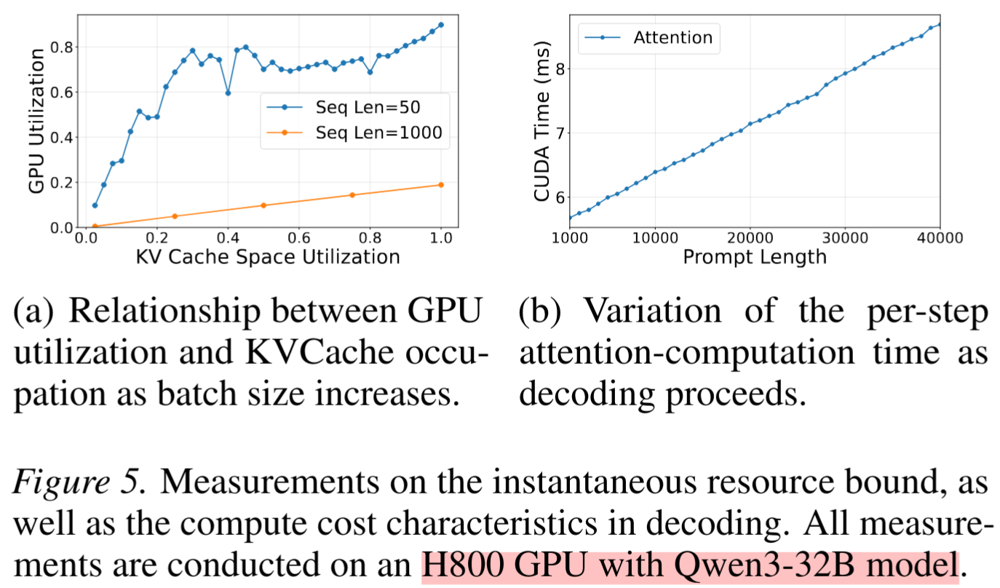
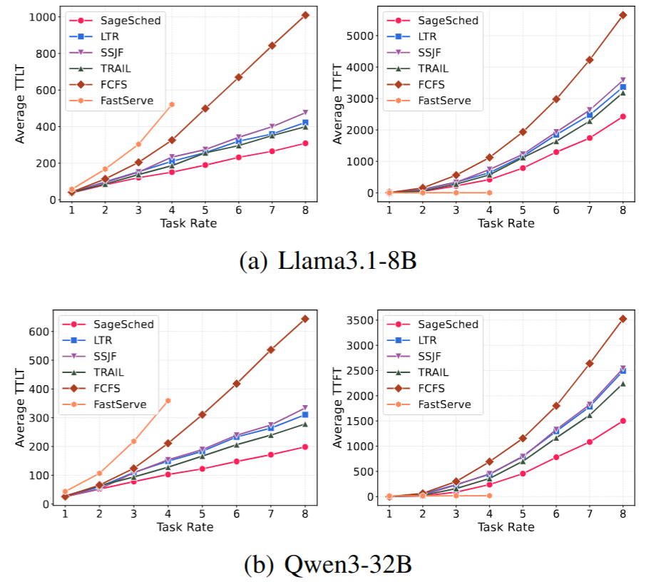

**SageSched: Efficient LLM Scheduling Confronting Demand Uncertainty and Hybridity（NeurIPS 2026，CCF-A）**
- 文章链接：https://arxiv.org/abs/2603.07917
- 代码链接：没开源，基于vLLM
- 简述：文章使用历史请求分布，获取当前这个请求的输出长度分布，再通过建模获取计算成本分布，最后通过Gittins准则计算指数，确定请求执行优先级。

# 1. 作者研究思路
作者认为，LLM 推理请求存在两个特点：长度不确定性（Uncertainty）和资源需求混合性（Hybridity）。

Uncertainty： 请求的输出长度事先未知，同一个 Prompt 在不同生成过程中也可能产生不同长度的输出。传统方法通常直接预测一个输出长度或请求优先级，不准确。

Hybridity： LLM 推理既消耗计算资源，也消耗 GPU 显存。尤其是 KV Cache 的占用与输入、输出长度均有关，因此仅根据输出长度排序，无法准确反映请求的实际服务成本。

## 1.1 输出长度分布的预测
作者通过计算请求与历史请求的相似度，把相似度高的所有历史请求拿出来，构建当前这个请求的输出长度分布。这个想法很奇妙，但是这个想法成立需要从两方面证明：

- 历史请求n个请求，与当前n个请求的请求输出长度分布具有很高的相似性(这里文中直接引用论文`Past-Future Scheduler`的实验，这个之前看过还算可靠)
- 通过embedings后的两个请求计算相似度，他们的输出长度分布也必须要相似度高。(这里作者用了一个小实验证明，感觉没那么靠谱)

## 1.2 计算成本分布
现有调度方法通常使用输出长度 \(O\) 衡量请求的服务成本，但忽略了输入长度和 KV Cache 的显存开销。为此，作者分别从显存和计算两个维度分析请求的资源消耗，并建立统一的成本模型。

- **显存成本：** 图(a)展示了不同序列长度下，随着 Batch Size 增大，GPU 计算利用率与显存占用的变化。短序列在显存耗尽前，GPU 计算利用率已经较高；而长序列可能在计算资源尚未充分利用时就耗尽显存，说明其更容易受到显存容量限制。因此，需要考虑请求在整个推理过程中累计的 KV Cache 占用。
- **计算成本：** 图(b)展示了单个请求在不同 Decode 步骤中的 Attention 计算耗时。实验发现，随着序列长度增长，Attention 计算耗时近似线性增加，因此可以通过累计各个 Decode 步骤的序列长度来估算总计算成本。

作者分别对两种资源消耗进行建模，发现它们具有相同的数学形式。设输入长度为 \(I\)，输出长度为 \(O\)，则：

\[
C_M \approx \left(IO+\frac{O^2}{2}\right)U_{MT}
\]

\[
C_C \approx \left(IO+\frac{O^2}{2}\right)U_{CT}
\]

其中，\(U_{MT}\) 和 \(U_{CT}\) 分别表示显存与计算的单位成本。由于两种成本具有相同的表达形式，作者将其统一为：

\[
\boxed{C=IO+\frac{O^2}{2}}
\]

也就是说在调度的时候不能仅考虑输出长度，还需要考虑`输入长度`。作者利用前面得到的输出长度预测分布，通过成本模型将其转换为请求的成本分布。

## 1.3 基于 Gittins 指数的请求调度
`Gittins 指数是一种将随机过程的未来收益或成本转化为单一数值，用于判断当前应该优先选择哪个任务的指标。`

作者采用 Gittins 准则，将每个请求的成本分布转换为一个指数，并据此决定调度优先级。这里不太懂不展开赘述了。

# 实验结果
实验使用 Llama 3.1-8B 和 Qwen3-32B，分别部署A40 48GB 和 H800 96GB GPU上。

图中：
- FCFS
- FastServe（MLFQ）：采用多级反馈队列，根据请求已经消耗的服务时间动态调整优先级
- SSJF（Speculative Shortest Job First）：使用轻量级模型预测请求的输出长度，并据此近似实现最短作业优先调度
- LTR（Learning to Rank）：通过学习排序模型预测请求的相对优先级，再按照预测排名进行调度
- TRAIL：采用基于请求长度预测的调度方法，并结合运行时信息动态调整请求优先级

可以看到该方法基本是最佳的，论文声称在该方法使 TTLT降低超过 28.7%。