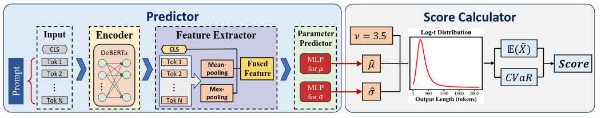
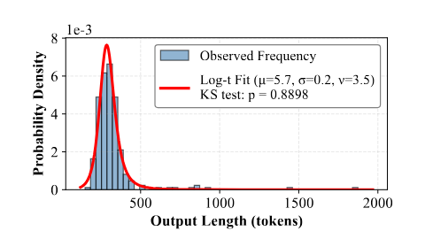
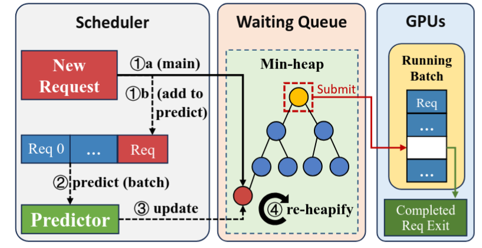
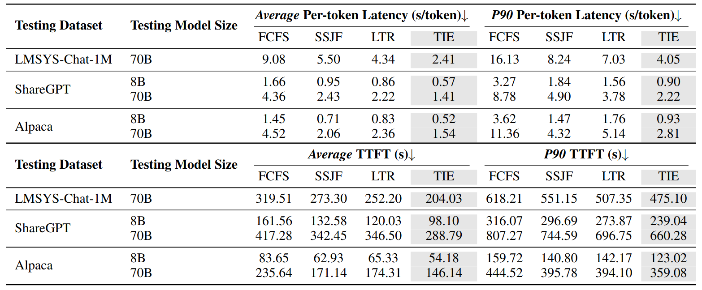
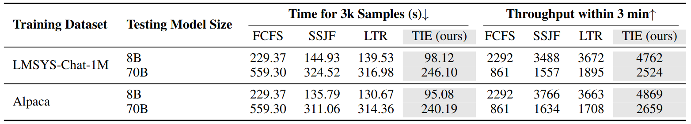

**Scheduling LLM Inference with Uncertainty-Aware Output Length Predictions| ICML 2026 | CCF-A**

  - 文章链接：https://proceedings.mlr.press/v306/zheng26ae.html
  - 代码链接：https://github.com/Hyzheng-code/TIE(基于vLLM)
  - 简述：针对现有调度方法仅预测单一输出长度、无法充分反映 LLM 输出不确定性的问题，作者使用 Log-t 分布对请求的输出长度进行建模，并提出结合输出长度期望与 CVaR 的 TIE 调度策略，以降低队头阻塞带来的延迟并提高推理吞吐量。

# 1. 文章认为目前的挑战
- 队列级阻塞仍然是一个开放的挑战：长时间运行的请求仍然可以阻塞队列中等待的较短的请求，从而导致平均延迟的增加和系统吞吐量的降低。
- 传统方法通常预测一个确定的输出长度，但 LLM 的自回归采样具有随机性，同一个请求多次执行也可能产生不同的输出长度。因此，单一长度预测难以充分反映请求的不确定性。

# 2. 文章设计思路
作者通过分析同一个 Prompt 的多次生成结果，发现输出长度具有明显的重尾特征，即大部分回答相对较短，但偶尔会出现特别长的输出。通过比较多种概率分布，作者选择 Log-t 分布对输出长度进行建模。

Log-t 分布包含三个参数：$\mu$、$\sigma$ 和 $\nu$。为了降低预测模型的复杂度，作者将自由度参数固定为 $\nu=3.5$，仅需预测 $\mu$ 和 $\sigma$ 即可确定对应的输出长度概率分布。

在此基础上，作者使用 DeBERTa 提取 Prompt 的语义特征，并通过 MLP 预测分布参数 $\mu$ 和 $\sigma$。最后，作者提出 TIE（Tail Inflated Expectation）指标，结合输出长度的期望与尾部期望，对可能产生超长输出的请求增加惩罚，并使用 TIE 替代传统 SJF 中的预测输出长度进行调度，以降低队头阻塞风险。

- 首先，在 Prompt 前添加 `[CLS]` 标记，并输入 DeBERTa 编码。随后，采用多池化策略融合三种特征表示：`[CLS]` 标记对应的全局语义表示、平均池化表示和最大池化表示。

- 接着，通过两个独立的 MLP 预测头分别预测 Log-t 分布的参数 $\hat{\mu}$ 和 $\hat{\sigma}$，并结合固定参数 $\nu=3.5$，构建该请求的输出长度概率分布。

- 最后，根据输出长度的期望 $\mathbb{E}(\tilde{X})$ 和条件风险价值（CVaR），计算 TIE 调度分数，以综合考虑请求的预期输出长度与长尾风险。

# 3.分析实验
## 3.1 概率分布的选择

作者从 LMSYS-Chat-1M 数据集中抽取 1000 个请求，每个请求分别生成 100 次回答。通过分析同一请求多次生成的输出长度，作者发现其分布具有明显的重尾（Heavy-tailed）特征，即大部分回答相对较短，但少数回答会产生很长的输出。

图中 Log-t 分布的 KS 检验结果为 $p=0.8898$，高于通常采用的显著性水平 $0.05$，说明Log-t 分布能够较好地拟合请求的输出长度分布。

考虑到分布参数越多，后续预测模型的复杂度越高，作者将 Log-t 分布的自由度参数固定为 $\nu=3.5$，仅需预测 $\mu$ 和 $\sigma$ 两个参数，即可确定对应的输出长度概率分布。这为后续的输出长度预测与调度优化奠定了基础。

## 3.2 预测概率分布的模型选择
作者使用 DeBERTa-v3-base 提取 Prompt 的语义特征，再通过 MLP 分别预测 Log-t 分布的两个参数 $\mu$ 和 $\sigma$。

训练完成后，模型只需输入新的 Prompt，就能预测其输出长度的概率分布，方便后续计算 TIE 调度分数。

## 3.3 TIE 调度分数计算
作者利用预测得到的 Log-t 分布参数 $\mu$ 和 $\sigma$，构建请求的输出长度概率分布，并计算两个指标：输出长度的期望 $\mathbb{E}[\tilde{X}]$ 和条件风险价值 $\mathrm{CVaR}_{0.9}(\tilde{X})$。其中，期望反映平均输出长度，CVaR 反映输出长度最高 10% 区域的平均值，用于衡量长尾风险。计算时，作者考虑了 `max_tokens` 的限制，将超过上限的输出长度截断为最大允许值。

在此基础上，作者提出 TIE 调度分数：

$$
\mathrm{Score}=\mathbb{E}[\tilde{X}]+\beta\cdot\mathrm{CVaR}_{0.9}(\tilde{X})
$$

其中，$\beta$ 用于调节对长尾风险的重视程度。等待队列越长，系统压力越大，$\beta$ 就越高，从而更加谨慎地调度可能产生超长输出的请求。调度器优先选择分数较低的请求执行。

此外，为避免长请求长期得不到调度，作者引入等待时间衰减机制：请求等待越久，其调度分数越低，从而逐渐提高优先级，兼顾调度效率与公平性。

# 4. 部署
论文基于vLLM 0.11.1 进行部署，大致结构如下：

论文使用最小堆维护等待队列，初始分数设为 `max_tokens`，使尚未完成预测的请求通常排在已预测请求之后。同时，新请求进入独立的预测队列，由后台线程异步批量预测。预测完成后，调度器更新请求的 TIE 分数，并重新调整最小堆，以便优先选择当前分数最低的请求。

这种设计能够减少预测过程对请求入队和调度的阻塞，并通过批量预测提高效率。

开源代码显示预测器需要单独一个显卡，但是文中并没详细写出如何部署。
# 5.实验
实验使用8张 NVIDIA A6000 (48 GB) GPUs 用 NVLink连接。128 个虚拟CPU核心。512 GB内存。测试两个模Meta-Llama-3-8B-Instruct 和Meta-Llama3-70B-Instruct。

调度策略：
- SSJF是使用微调后的Bert直接预测输出长度
- LTR使用OPT学习请求输出长度的相对顺序

在 **100 RPS** 的请求到达速率下，测试不同模型规模和数据集上的在线服务性能。TIE 在不同模型和数据集上均表现较好。

评价指标为生成 3000 条样本所需的时间和 3 分钟内生成的样本数量。同样TIE性能最佳。

# 6.其他
- 文章训练模型使用了45,000条请求，每个重复20次。感觉重复次数太少了。不过文章中有实验验证少数的重复次数也可以得到比较可靠的分布。