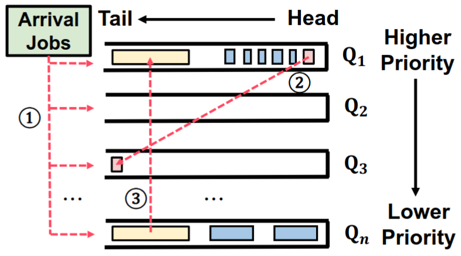
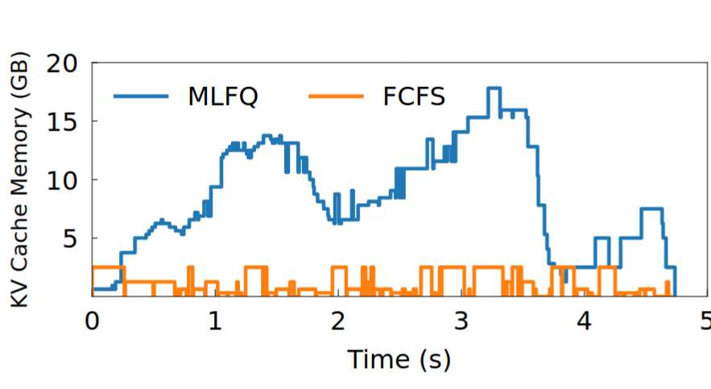
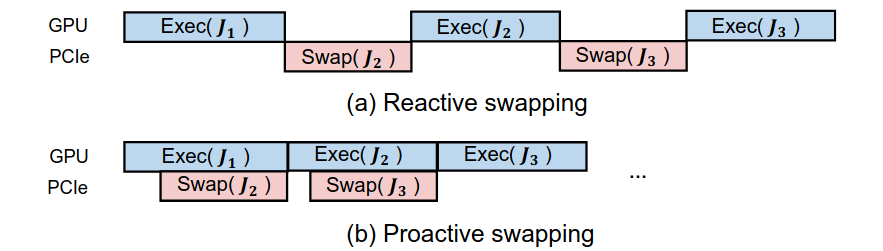
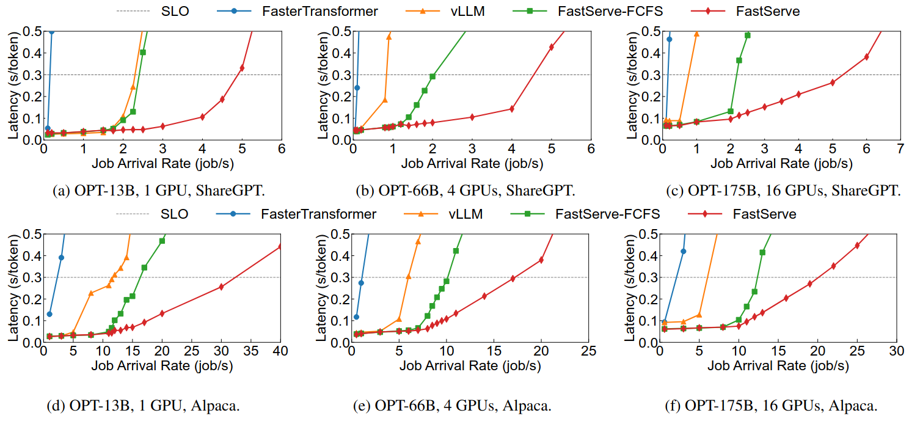
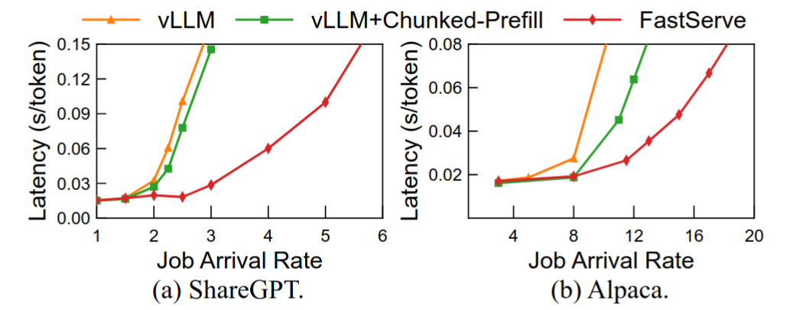

FastServe: Iteration-Level Preemptive Scheduling for Large Language Model  Inference（NSDI 2026， ccfa）
- 文章链接：https://www.usenix.org/conference/nsdi26/presentation/wu-bingyang(最早23年上传，后改名)
- 代码链接：https://github.com/LLMServe/FastServe(25年上传)
- 简述：文章在请求级别调度层面引入多级反馈队列，和KV缓存管理的策略。

文章使用改良的多级反馈队列进行调度，但是没和其他人的工作进行比较如输出长度预测等工作进行比较。只和vLLM比较。

# 1. 文章认为的挑战
- 机会： 目前系统通常采用先来先到和非抢占式，容易造成对头阻塞，可以通过在decode阶段进行抢占，来降低请求等待时间
- 每个请求输出长度不同，并且输入输出长度不相关
- GPU内存开销大，抢占式调度会造成大开销

文章做了两方面的工作一个是改良的多级反馈队列(允许抢占)，一个是KV缓存的管理

# 2. 多级反馈队列的设计

如图存在多个优先级队列，优先级从高到低，队列运行执行的时间片从短到长。请求执行时间超出当前队列的时间片，降级到下一级。调度策略如下：

1. 根据profiler预测请求prefill所需要的时间，根据这个时间筛选时间片接近的队列
2. 请求运行时间超出当前队列的时间片，降级到下一个队列
3. 根据队列优先级构建Batch
4. 为避免请求饿死，等待时间超过300ms，直接放入到最高优先级队列

# 3. KV缓存的管理

文章所用的多级反馈队列会加剧内存开销。对此文章从两方面构思：

1. 延迟新请求的执行
2. 释放低优先级请求的KV缓存，重新计算

这两个解决方案都会导致不同的问题，作者最后想出，将低优先级队列中的请求的KV offload到CPU内存上。这个方法需要考虑KV传输的开销，文章在执行前一个任务的时候，会提前传输下一次执行所需的KV缓存。

这里同样还需要考虑频繁的换入和换出会产生额外的开销，因此提出 ENST（Estimated Next Scheduled Time），用于预测每个请求下一次被调度执行的时间。

它考虑两个因素：

- \(T_{promote}\)：请求等待多久后会因为防止饥饿而提升到最高优先级。
- \(T_{execute}\)：前面高优先级请求执行完并逐渐降级，需要等待多久。

最终取两者较小值：

\[
ENST(i)=\min(T_{promote}(i),T_{execute}(i))
\]

# 4. 实验 
- 设备：两台 AWS EC2 p4d.24xlarge，每台配备 8 张 NVIDIA A100 40GB GPU（NVLink 互联）和 1152 GB 主机内存

- 模型： 使用 OPT 系列模型（13B、66B、175B），以及Llama3-8B，所有实验均采用 FP16 精度

- 数据集： 使用 ShareGPT 和 Alpaca 数据集模拟真实请求，并通过泊松分布生成请求到达时间

- 比较对象：FasterTransformer v5.3(2023.1); vLLM v0.6.1(2024.9)

## 4.1 和chunk prefill 比较

